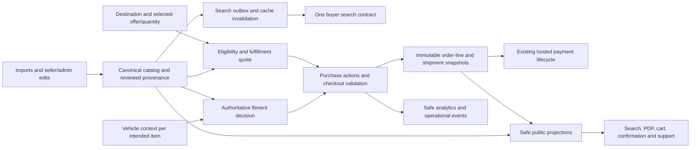

# Developer optimization report: application comparison and implementation plan

**Last reviewed:** 2026-10-09  
**Status:** First local implementation tranche completed; remaining packages and release gates are tracked in section 13.  
**Scope:** Buyer marketplace, shared catalog contracts, API, ingestion, fulfillment, payments, operations, and the seller/admin surfaces needed to maintain their data.  
**Source:** `C:/Users/Irtaza Hassan/Downloads/PartsBazar360_Developer_Optimization_Report.pdf`, all 30 pages, including the reference screenshots on pages 4-8.  
**Related notes:** [[../Home]], [[../apps/buyer-marketplace]], [[../apps/api]], [[../packages/catalog-contracts]], [[../SEO_ARCHITECTURE]], [[../CHECKOUT_GUEST_FIRST]], [[BUYER_UX_CRO_AUDIT_2026-09-17]].

## 1. Assessment

The report identifies the right commercial objective: resolve fitment, product identity, delivery eligibility, cost, and purchase risk before asking the buyer to pay. The application already has much of the underlying machinery. The implementation should connect and correct that machinery, with selective additions, rather than begin with another marketplace redesign or a replacement payment architecture.

The most urgent findings are:

1. **Supplier privacy is not enforced at the buyer API boundary.** Live product/search responses expose supplier names and identifiers. Local cart, quote, order, notification, and UI paths also carry supplier information. Hiding a visible name alone will not meet the report's requirement.
2. **Fitment evidence can be promoted beyond what it proves.** A live `CONFIRMED` result was supported by `TITLE_MVL` evidence. Ingestion assigns B/0.9 to candidates after matching a vehicle in MVL; this verifies vehicle identity, not necessarily the relationship between this part and that exact configuration. The browser also independently promotes YMM table matches to verified fitment.
3. **Shipping estimates exist, but eligibility is incomplete.** Actual/volumetric weight, estimated weights, country rates, PDP quotes, and server-side freight blocking are implemented. Product DG restrictions and a supported-service eligibility decision are missing from the reviewed paths. An unmatched destination received an automatic averaged price in production.
4. **Search has two operational paths with different behavior.** The storefront's legacy endpoint failed a separator-normalization check that the existing versioned endpoint passed. Reuse and validate the newer query/index pipeline before writing another search engine.
5. **The purchase flow does not use fitment as an authoritative transaction decision.** Purchase CTAs remain static; compatibility confirmation is universal and browser-based; cart/order lines have no dedicated fitment decision snapshot.
6. **Several recommendations are partly or substantially complete.** These include collapsed compatibility rows, gallery zoom, a mobile sticky bar, guest checkout recovery, branded payment-return pages, basic ecommerce analytics, and the programmatic SEO engine. They need targeted extension and verification.

The report's sequence should be adjusted: supplier projection, truthful fitment evidence, shipping eligibility, and the reproduced exact-number defect deserve early attention. Baseline analytics belongs at the beginning, while experimentation and SEO expansion follow reliable transaction controls.

## 2. Evidence, scope, and limitations

### 2.1 What was inspected

- Read and extracted all 30 report pages; rendered the pages and inspected their layout and reference imagery.
- Read the repository map and relevant architecture notes; checked source implementations rather than treating documentation as proof of current behavior.
- Reviewed the current working tree, including pre-existing local edits. Local HEAD was `e56a642c535919c0e82e63372e780b9af48caa85`.
- Used the supplied SSH access for read-only inspection of `/home/ubuntu/PartsBazar360` and running services. Server HEAD was `cb8c58af42935000f4dd3e18ea4fdc5df176d887`; that checkout also had local modifications. A commit ID alone is therefore not a complete deployment manifest.
- Compared normalized source hashes for `fitment-check.service.ts`, `shipping.service.ts`, `search.controller.ts`, and `BuyBox.tsx`: local and server copies matched after normalizing Windows line endings.
- Checked the running API's compiled fitment/shipping modules: the average-rate fallback and fixed 0.9 MVL evidence promotion were present in runtime code.
- Sampled live public search, product, fitment, shipping, robots, sitemap, and invalid-pagination GET requests.
- Ran eight existing local API test suites: **186 tests passed** across shipping, billable weight, freight blocking, shipping summaries, query parsing, relevance, browse queries, and vehicle identity.

No production carts, orders, payment sessions, support tickets, messages, database migrations, deployments, or administrative changes were created. No production credentials were copied into this document.

### 2.2 How to interpret the results

**Live verified** means a sampled production response demonstrated the behavior. **Source verified** means the reviewed implementation contains it. **Partial** means useful foundations exist but at least one acceptance condition remains unmet. **Not found** means the capability was not located in the reviewed relevant paths; it is not proof that no external/manual system exists.

Production counts are a point-in-time sample from 2026-10-09, not a database-wide audit. Request durations were small-sample observations, not load-test or latency SLO measurements. Existing tests passing does not establish report compliance: they do not cover the new policy and evidence requirements.

Browser automation could not initialize because of a Windows sandbox error. Live interactive layout, mobile Safari behavior, wallet availability, Stripe Dashboard branding, real payment completion, and customer email delivery were not exercised. The report's screenshots, current source, public HTML/status responses, and live API behavior support this comparison. Device and hosted-payment verification remain explicit release gates.

### 2.3 Reproduced production examples

| Check                                                                                                           | Observed result                                                                                                                                       | Interpretation                                                                                                                                                  |
| --------------------------------------------------------------------------------------------------------------- | ----------------------------------------------------------------------------------------------------------------------------------------------------- | --------------------------------------------------------------------------------------------------------------------------------------------------------------- |
| `/api/search/parts?limit=2`, page 2, and `countOnly=true`                                                       | All returned total `81,560`; count relation was `eq`.                                                                                                 | The sampled broad catalog count reconciles. Do not declare the report's historical count defect currently universal.                                            |
| `category=General`, normal and count-only requests                                                              | Total `9,774`, approximately **11.98%** of the sampled broad count. An oil filter and numerous tie rods appeared in this category.                    | Catch-all classification remains a real cleanup opportunity; the numerator/denominator are endpoint results, not a full eligibility reconciliation.             |
| `/buyer/parts/category/general/page/999999`                                                                     | HTTP 404.                                                                                                                                             | A current out-of-range route is correctly rejected. Final-page, filter, and alternate-stack regressions still need coverage.                                    |
| Legacy search `q=3W0121064F`                                                                                    | One result, the expected Bentley coolant pipe.                                                                                                        | Baseline identifier exists in the active storefront catalog.                                                                                                    |
| Legacy search `q=3W0-121-064-F`                                                                                 | Sixteen results; first results were unrelated thermostats/water pumps.                                                                                | A specific separator-normalization/ranking defect is reproduced.                                                                                                |
| `/api/v1/search` for those same two forms                                                                       | Both returned the same expected part, one result, `meta.index=parts_search`, `degraded=false`.                                                        | The newer existing pipeline solves this sample. Migration still needs parity checks for filters, facets, availability, and pagination.                          |
| Product `c7550964-bc7d-43f7-b58c-0f7b1d88ecea`, fitment check for config `db01ad70-44f6-43f1-a936-29c72d8ab7f5` | `CONFIRMED`, B/0.9, evidence source/type `TITLE_MVL`, reason describing a YMM match.                                                                  | The evidence classification needs correction before confirmed-fit messaging is expanded. This does not prove the part is physically incompatible.               |
| Sampled public PDP responses                                                                                    | Supplier objects contained `name`, `storeId`, organization/onboarding fields; offers exposed source tags. Some parts exposed an external listing URL. | Supplier privacy fails beyond visible UI text. Values are deliberately omitted here.                                                                            |
| Sampled NAPA muffler quote to Antarctica                                                                        | HTTP 200, `matchedCountry=false`, automatic AED 1,913.41 rate, 8-14-business-day estimate.                                                            | An unmatched country receives a chargeable-looking fallback. This is not evidence of a valid carrier service.                                                   |
| Same muffler to UK/UAE                                                                                          | Destination-specific quotes returned.                                                                                                                 | PDP destination quoting already works and should be retained.                                                                                                   |
| Sampled bumper-class listing                                                                                    | `requiresFreightQuote=true`; quote includes a capped numeric amount.                                                                                  | Freight detection exists, but the amount is a floor and must not appear as an authorized final price. The sampled title may also warrant classification review. |
| `/buyer/robots.txt` and `/buyer/sitemap.xml`                                                                    | HTTP 200.                                                                                                                                             | SEO runtime routes are already deployed; content correctness was not exhaustively crawled.                                                                      |

A coolant pipe, battery tray, airbag sensor, or clock spring must not be treated as a dangerous good merely because its title contains a related word. The audit did not establish a specific completed DG mis-shipment or submit an actual DG checkout. The DG finding concerns missing policy/data/enforcement in the inspected application.

## 3. Requirement-by-requirement comparison

Report IDs and page references below preserve traceability. Status reflects current evidence, not estimated implementation percentage. Evidence anchors E01-E16 are in section 12; work packages are in section 6.

### 3.1 P1: transaction correctness and conversion

| Report item                                 | Current application                                                                                                                                                                                                                                                         | Remaining work                                                                                                                                         | Delivery |
| ------------------------------------------- | --------------------------------------------------------------------------------------------------------------------------------------------------------------------------------------------------------------------------------------------------------------------------- | ------------------------------------------------------------------------------------------------------------------------------------------------------ | -------- |
| **P1-01 Fitment engine**, p10               | **Partial.** `FitmentCheckService` and `/fitment/check` exist; canonical configurations and evidence records exist. Browser evaluation is separate. `CONFLICT` is not produced by the reviewed API; missing-detail logic is limited. Evidence promotion is unsafe. E01-E03. | Correct evidence provenance, make one server verdict authoritative, request only missing attributes, persist per-line decisions and order evidence.    | W02, W05 |
| **P1-02 Fitment-aware CTAs**, p11           | **Not met; UI groundwork exists.** Garage and badges exist, but desktop/mobile add/buy actions ignore the decision. E02, E04.                                                                                                                                               | Use one purchase-action policy for desktop, mobile, search quick actions, and checkout. Preserve deliberate exact-number buying.                       | W03, W05 |
| **P1-03 Purchase card**, p11-12             | **Partial.** Sticky rail, prices, offers, fitment checker, destination quotes and trust copy exist. Price follows other controls; internal/supplier details remain; no unified delivered-total decision. E04.                                                               | Reorder the existing card around selected offer, decision, eligibility, delivered estimate, and dominant action.                                       | W03      |
| **P1-04 PDP shipping/cost/ETA**, p12        | **Partial, live verified.** Public quote hook/endpoint and weight-based ETA already exist. Quote is part-level rather than offer/origin/quantity-specific; no eligibility result; fallback rates and stale quote risk remain. E05-E06.                                      | Extend one quote service across PDP/cart/checkout with real eligibility, quote freshness, quantity, currency and offer context.                        | W04, W03 |
| **P1-05 Supplier masking**, p12-13          | **Not met, live verified.** Public API, cards, source pills, warehouse fields, support subjects and notifications expose identity/provenance. E04, E07-E08.                                                                                                                 | Introduce safe public projections, sanitize content/media exposure, invalidate caches, replace seller contact copy, retain private operations access.  | W01      |
| **P1-06 Condition/source labels**, p13      | **Partial.** Controlled part types, condition fields, MPN/OE fields and shared labels exist. Genuine OEM suppresses condition; source tags remain; legacy search and PDP shapes differ. E09.                                                                                | Separate condition, source, brand, number roles; retain supported exceptional states; remove unsafe fallbacks and validate imports.                    | W06      |
| **P1-07 DG/freight eligibility**, p13-14    | **Partial.** Dimensional weight and freight flags/blocking exist. No reviewed product DG policy or per-service eligibility enforcement. E05-E06.                                                                                                                            | Add reviewed product/offer shipping profiles and carrier policy, enforce before reservation/payment and on retry, provide specific basket remediation. | W04, W05 |
| **P1-08 Risk-adaptive checkout**, p14-15    | **Not met; strong checkout base.** Guest drafts, OTP handling, two checkout steps and retry/idempotency exist. Compatibility checkbox is universal and not a server fitment requirement. E10.                                                                               | Derive risk and required acknowledgments on the server per line; skip redundant confirmation only when justified.                                      | W05      |
| **P1-09 Stripe continuity**, p15            | **Partial.** Hosted Checkout, email prefill, amount wording, webhooks and branded success/cancel pages exist. Name/address are not passed in the reviewed interface; summary is one aggregate order line. Dashboard branding/wallets unverified. E11.                       | Extend supported prefill, improve order summary and branding, verify mobile methods, preserve amount reconciliation and payment lifecycle.             | W07      |
| **P1-10 Counts/pagination/mapping**, p15-16 | **Partial; sampled count/404 checks pass.** Exact totals, result-window guards and taxonomy last-page checks exist. Dual search paths and category cleanup remain. E12-E13.                                                                                                 | Reconcile eligibility/count definitions, test all filter modes, fix confirmed defects rather than presume every historical bug persists.               | W08, W06 |

### 3.2 P2: discovery and purchase usability

| Report item                                   | Current application                                                                                                                                                              | Remaining work                                                                                                                      | Delivery |
| --------------------------------------------- | -------------------------------------------------------------------------------------------------------------------------------------------------------------------------------- | ----------------------------------------------------------------------------------------------------------------------------------- | -------- |
| **P2-01 Compatibility disclosure**, p18       | **Largely present, incomplete verdict integration.** Table previews ten rows with filter and show-all. Evidence chips/long descriptions may still expand page length. E14.       | Put selected-vehicle verdict first; bound additional evidence lists; expose safe evidence details on demand.                        | W03      |
| **P2-02 Image semantics**, p18-19             | **Partial.** Deduplication, zoom, thumbnails, keyboard controls and missing-image handling exist. Plain URL arrays do not express actual-unit versus reference photography. E14. | Store media provenance/verification per image or gallery; order useful views; review banner and supplier-watermark leakage.         | W09      |
| **P2-03 OE/MPN search**, p19                  | **Partial with reproduced storefront defect.** Normalization/ranking/interchange/supersession code already exists in the newer stack. E12.                                       | Reuse it in the active buyer path, measure parity and preserve exact-match dominance.                                               | W08      |
| **P2-04 No-result recovery**, p19-20          | **Partial.** Existing zero-result actions offer sourcing support and interchange matching. Context is mostly query text in a subject. E15.                                       | Attach structured query/vehicle/destination/intent, show justified alternatives, and connect submitted leads to orders.             | W10      |
| **P2-05 Taxonomy cleanup**, p20               | **Partial.** Category/group/system, classification status/confidence, import and admin foundations exist. General remains material in the live sample. E09, E13.                 | Reviewable deterministic/high-confidence mapping, controlled backfill, publication checks and weekly quality report.                | W06      |
| **P2-06 Make/brand/supplier separation**, p20 | **Partial.** `VehicleMake`, `BrandMaster`, aliases and seller entities exist. Frontend brand strings/source tags can still mix roles. E09.                                       | Enforce entity-specific imports/directories and render distinct make/parts-brand sections from clean data.                          | W06      |
| **P2-07 Alternatives/cross-sell**, p20-21     | **Partial.** Related candidates and shared scoring exist. The server-rendered block does not receive the browser's selected garage/destination context. E16.                     | Separate substitutes from repair companions and filter/rank through trusted fitment and eligibility.                                | W11      |
| **P2-08 Mobile sticky bar**, p21              | **Partial.** A safe-area-aware bottom bar already exists; WhatsApp is offset above it. Static CTA and supplier/source text remain. E04.                                          | Reuse purchase decision state; show compact fitment and expandable delivery information; run actual device checks.                  | W03, W12 |
| **P2-09 Seller performance layer**, p21-22    | **Partial.** Profile SLA/return data exists. Identity-safe, sufficiently sampled performance calculations were not found. E07-E08.                                               | Publish only validated platform metrics with sample thresholds and recency; avoid unsupported verification claims.                  | W13      |
| **P2-10 Shorter PDP**, p22                    | **Partial.** Table preview is present; long description and other reference content remain open. E14.                                                                            | Decision-critical content remains visible; accessible disclosure for descriptions, OE lists, policy details and reference evidence. | W03, W09 |

### 3.3 P3: measurement and growth

| Report item                             | Current application                                                                                                                                                     | Remaining work                                                                                                                           | Delivery |
| --------------------------------------- | ----------------------------------------------------------------------------------------------------------------------------------------------------------------------- | ---------------------------------------------------------------------------------------------------------------------------------------- | -------- |
| **P3-01 Events**, p23-24                | **Partial.** GTM `view_item`, `add_to_cart`, `begin_checkout`, `purchase`, backend purchase payload and checkout-event allowlists exist. E10-E11.                       | Add fitment/search/shipping/recovery events and safe dimensions; maintain existing ecommerce names and deduplication.                    | W00, W14 |
| **P3-02 Dashboard**, p24                | **Not found for this buyer funnel.** General merchant analytics is not evidence of the requested CRO dashboard.                                                         | Define denominators and segments; publish weekly friction views, refund/return and operational guardrails.                               | W14      |
| **P3-03 A/B program**, p24              | **Not found as a consistent storefront experiment framework.**                                                                                                          | Add stable assignment/exposure tracking; test presentation after correctness gates, with operational/statistical review.                 | W15      |
| **P3-04 Programmatic SEO**, p25         | **Substantially implemented.** Shared pure SEO engine, stable slugs/redirects, taxonomy routes, canonicals/robots, JSON-LD, sitemaps and indexability gates exist. E13. | Audit quality/count/supplier-safe structured data, maintain current SEO, then selectively extend useful inventory-backed pages.          | W08, W16 |
| **P3-05 WATI escalation/recovery**, p25 | **Partial channel foundation.** Platform WhatsApp link, support tickets and email/SMS notifications exist; a contextual WATI integration was not found. E15.            | Extend existing support records with context, consent and attribution; add asynchronous provider adapter and inbound reconciliation.     | W10      |
| **P3-06 Post-purchase**, p25-26         | **Partial.** Authorized order read, payment polling, totals, account offer, fulfillment fields and notifications exist. E08, E10-E11.                                   | Add safe shipment cards, item and fitment snapshots, dispatch/delivery expectations, returns/support and secure guest access continuity. | W12      |
| **P3-07 Bundles**, p26                  | **Partial related-product base.** No reviewed fitment/eligibility-gated service bundle engine. E16.                                                                     | Curate repair relationships, validate each item for vehicle/destination, measure attach rate without distracting checkout.               | W11      |

### 3.4 P4: strategic capabilities

| Report capability, p27    | Current foundation                                                                        | Remaining work / sequencing                                                                                                                  |
| ------------------------- | ----------------------------------------------------------------------------------------- | -------------------------------------------------------------------------------------------------------------------------------------------- |
| VIN/chassis decoding      | VIN can be recorded in garage; no decoder integration found.                              | Add a provider adapter after vehicle identity is reliable; VIN identifies a vehicle and never proves part fitment. W17.                      |
| Evidence/confidence graph | `Fitment`/`FitmentEvidence`, typed number records and confidence fields exist.            | Correct provenance now; later add source lineage, supersession/equivalence edges and conflict review. W02, W17.                              |
| OE/interchange comparison | Identifier types, multiple offers, related scoring and newer search exist.                | Compare evidence-backed equivalents without collapsing distinct brands, sides, kits, or supersession direction. W11, W17.                    |
| Normalized My Garage      | Device-local canonical config selection plus authenticated backend garage endpoint exist. | Add guest-to-account merge/sync, market/year/detail fidelity and per-line intended vehicle. Do not replace with a new graph first. W02, W17. |
| Supplier SLA engine       | Private seller profile, seller orders and operational timestamps/status exist.            | Stabilize eligible denominators and audited metric windows before showing quality claims. W13.                                               |
| Multi-origin shipping     | Warehouses and seller-grouped shipping exist; current rate model primarily assumes UAE.   | Make origin explicit in W04, but activate other origins only after stock routing, carrier rules, pricing and operational validation. W17.    |

## 4. Target architecture and contracts

Keep the current modular NestJS application, Next.js buyer, PostgreSQL/Prisma, Redis/BullMQ, OpenSearch, and shared contract package. The report's service names describe responsibilities; they do not justify separate deployed microservices.



### 4.1 Fitment decision

Add a shared **buyer decision contract** without immediately replacing historical catalog/import statuses. Existing `LIKELY`, `OEM_NUMBER_MATCH`, `NOT_VERIFIED`, and `DETAILS_REQUIRED` values need an adapter and versioned rollout, not an uncontrolled enum rename across portals.

Proposed core shape:

```ts
type FitmentDecision = {
  decisionId: string;
  partId: string;
  vehicleConfigId: string | null;
  status: "CONFIRMED" | "NEEDS_DETAILS" | "UNVERIFIED" | "CONFLICT";
  vehicleSelection: "NONE" | "PARTIAL" | "EXACT";
  applicability: "VEHICLE_SPECIFIC" | "UNIVERSAL";
  missingVehicleFields: string[];
  evidenceSummary: { kind: string; publicExplanation: string }[];
  safeActions: string[];
  policyVersion: string;
  evaluatedAt: string;
  catalogRevision: string;
};
```

- The server owns the verdict. Browser components render it and may not independently upgrade it.
- No selection is a separate context, not a fabricated incompatible result. Universal products have dimensional/use constraints; universal does not automatically mean confirmed for every vehicle.
- `CONFIRMED` needs evidence for the **part-to-configuration relationship**, including relevant engine, trim, market, production date and exclusions. A vehicle's presence in MVL or an OE number existing on a part is insufficient by itself.
- `NEEDS_DETAILS` requires a known, resolvable missing discriminator. An unknown catalog gap should remain `UNVERIFIED` rather than repeatedly demanding details that cannot resolve it.
- `CONFLICT` needs explicit contradictory or exclusion evidence. Absence from an incomplete compatibility table is not proof of incompatibility.
- Public evidence summaries must omit supplier names, external supplier listing references and private reviewer details. Full evidence IDs/records remain available to authorized operations.
- Cache decisions by part revision, configuration/detail fingerprint and policy version. Use bounded/batched lookup for cards and cart lines; do not fetch entire PDP evidence graphs per line.

### 4.2 Fulfillment eligibility and quote

Extend the current quote service with a shared result that distinguishes supported parcel pricing, blocked delivery, manual freight, and review-required inventory. Use ISO country codes at the boundary and keep labels for display.

```ts
type FulfillmentQuote = {
  quoteId: string;
  status: "AVAILABLE" | "BLOCKED" | "REQUIRES_QUOTE" | "NEEDS_REVIEW";
  lines: { cartItemId?: string; offerId: string; quantity: number }[];
  destinationCountry: string;
  currency: string;
  amount: number | null;
  estimated: boolean;
  reasonCode: string | null;
  serviceName: string | null;
  billableWeightKg: number | null;
  dispatchBusinessDays: { min: number; max: number } | null;
  transitBusinessDays: { min: number; max: number } | null;
  expiresAt: string;
  rateVersion: string;
  policyVersion: string;
};
```

Internally the quote also records private fulfillment group/origin, package evidence, service constraints, dimensions, weight basis, FX rate and calculation inputs. Public responses use non-identifying shipment labels and safe origin country only.

Key invariants:

- `amount` is null for blocked, review-required, or unapproved freight flows. A capped parcel-rate floor is not an approved freight quote.
- A destination missing an approved carrier/service route cannot become purchasable through averaged rates. A marketing estimate, if retained, must be explicitly non-purchasable and distinct from a validated quote.
- DG classification and shipping size class are separate: a standard-sized package can still be restricted. Effective offer/unit restrictions may be stricter than canonical-part defaults.
- Quote input includes selected offer, quantity, origin, destination, package data and charge currency. The current one-part/one-unit quote is an adapter during migration.
- PDP, cart and checkout share calculations; a combined basket can legitimately change shipping through grouping, quantity or packaging. Explain changes instead of promising identical amounts for different shipment inputs.
- Show item plus shipping as an **estimated delivered subtotal** when tax/duties are not known. Do not call it an all-inclusive landed price unless those amounts and responsibilities are actually supported.

### 4.3 Checkout validation and order record

Introduce a server validation operation before payment, reused by order creation and retry. Proposed route: `POST /checkout/:cartId/validate`. It returns a validation ID/fingerprint, per-line fitment and shipping decisions, required acknowledgments and specific remediation actions.

The final checkout request references this validation and the acknowledgments. The server revalidates current catalog/inventory/policy and never trusts client-sent `CONFIRMED`, `allowed=true`, prices, or bypass flags. Bind acknowledgments to the cart revision, line, vehicle, decision and policy version. A changed vehicle, destination, offer or quantity invalidates relevant stale decisions.

Store immutable product identity/condition/media claims, selected vehicle context, fitment decision/evidence references, acknowledged purchase intent, fulfillment quote, shipping/discount/tax basis and policy versions with the order. Existing price snapshots are valuable, but joining a later-mutated product title or compatibility row is not a complete historical snapshot.

### 4.4 Safe buyer domain

Introduce explicit allowlisted DTOs for buyer product, offer, cart, quote, order, support receipt and notification views. Retain private seller relations for inventory, routing, settlement, seller/admin portals and support assignment.

Permitted public information includes a truthful platform supplier label, country-level origin, relevant return policy, verified metrics and product manufacturer brand. Supplier legal name, store identity, warehouse names, direct links/contacts, onboarding notes, raw provenance tags and internal costs must not flow through buyer DTOs. Legitimate product brands must remain distinct from supplier identities; a shared string is not enough to decide its role.

Server projection must happen before Next.js rendering and JSON-LD generation: server-rendered HTML, React serialization and browser network responses can leak data even if no visible component prints it.

## 5. Data changes and migration strategy

### 5.1 Proposed schema additions

Names are implementation proposals, not claims about existing models.

| Area             | Reuse                                                                                    | Add or extend                                                                                                                                                 | Historical handling                                                                                                                                                    |
| ---------------- | ---------------------------------------------------------------------------------------- | ------------------------------------------------------------------------------------------------------------------------------------------------------------- | ---------------------------------------------------------------------------------------------------------------------------------------------------------------------- |
| Vehicle identity | `VehicleMake`, aliases, model/generation/configuration, `UserVehicle`                    | Detail/market/year fidelity and an identity revision; partial selection DTO; authenticated garage synchronization                                             | Preserve configuration IDs; migrate local garage records with an explicit schema version. Avoid destructive deduplication without foreign-key mapping.                 |
| Fitment evidence | `Fitment`, `FitmentEvidence`, original data/source records                               | Distinguish `vehicleIdentityValidated` from `partFitmentVerified`; retain exclusions, applicability scope, source lineage, policy revision and review outcome | Reassess title-derived/MVL-existence-derived claims. Do not erase their original provenance or overwrite stronger manually verified evidence.                          |
| Cart intent      | `Cart`, `CartItem`, `CheckoutSession`                                                    | Per-line intended vehicle, purchase intent, decision reference and acknowledgment context                                                                     | Existing carts begin as legacy/unevaluated; recompute before payment. One global active vehicle must not silently replace different intended vehicles in a mixed cart. |
| Order evidence   | `Order`, `SellerOrder`, `OrderItem`, `PaymentAttempt`                                    | Versioned immutable line snapshot and shipment/quote snapshot; decision evidence references and acknowledgment audit                                          | Existing orders have `legacy/no captured decision` where appropriate; never invent past confirmations. Keep historical paid totals unchanged.                          |
| Shipping profile | Existing part weight/source/confidence, dimensions, class key, offer/inventory/warehouse | Reviewed restriction status/type, packaging provenance, service eligibility, internal origin and offer/unit overrides                                         | Initialize as unreviewed, prioritize risky classes, and distinguish audited parcel-eligible stock from uncertain inventory.                                            |
| Carrier policy   | Existing UAE tiers and EMX sheet                                                         | Versioned service coverage, weight/dimension limits, DG permission, effective dates, origin and transit/handling rules                                        | Import current agreed rates as version 1 only after operations confirms their contractual range. Do not infer a 30 kg rate contract from a software ceiling.           |
| Freight workflow | `SupportTicket`, existing freight category and quoted-rate fields                        | Structured request context, approved quote reference, expiry and scope; server acceptance for a matching basket                                               | A support message or arbitrary payment link is not proof of DG eligibility or a freight-approved marketplace order.                                                    |
| Media            | Existing images and enrichment evidence                                                  | Image kind, exact-unit association where relevant, approved ordering, verification status and provenance                                                      | Unknown imagery remains unknown; new/used condition alone cannot prove that photos show the actual unit.                                                               |
| Recovery         | Support ticket and checkout events                                                       | Versioned request context, journey/request correlation, consent and lead-to-order link                                                                        | Keep existing support submissions working; project only safe receipt fields to guests.                                                                                 |
| Performance      | Seller profiles/orders and fulfillment updates                                           | Audited aggregate metrics, time window, sample size and recency                                                                                               | Show no numerical score until its eligible denominator and sample threshold are met.                                                                                   |

Condition belongs to an offer or actual inventory unit when multiple suppliers sell differently conditioned items under one canonical part. Catalog-level defaults must not overrule the selected offer. Keep `FOR_PARTS`/non-working inventory explicit or make it ineligible by an agreed policy; the report's four condition labels are not a reason to mislabel existing non-working stock.

### 5.2 Safe rollout of data changes

1. Add nullable fields/tables and versioned contracts; deploy tolerant readers first. Do not make every historical record satisfy a new required field immediately.
2. Produce a read-only audit: title-derived confirmed fitment, contradictory evidence, General categories, role-invalid brands, raw supplier leakage, restriction candidates, missing package data and quote-only inventory.
3. Review representative samples with catalog/operations staff. Define evidence qualification, conflict override policy and carrier permissions before generating broad claims.
4. Run dry-run backfills with stable IDs, source revisions, expected row counts and rollback snapshots. Apply bounded batches with resume checkpoints and compare-and-set checks so concurrent listing updates are not overwritten.
5. Repair upstream ingestion and seller/admin validation **before** backfilling, otherwise later imports recreate the defects.
6. In the same write transaction, create search-outbox entries where relevant. Rebuild the new search index and verify projection freshness, visibility, counts and pricing before switching readers. During a temporary dual-index period, explicitly track both projections; the newer outbox does not by itself prove the legacy index is current.
7. Invalidate/version API caches, Next.js page data and SEO aggregates after changes. Fitment/quote caches must include policy revisions. Supplier projection changes need cache replacement so old serialized identity is not served again.
8. Expand enforcement by audited cohorts, with explicit review/manual handling for unclassified risk. Do not silently treat missing restriction data as international approval. Avoid freezing the entire catalog when reviewed low-risk cohorts can safely remain purchasable.
9. Preserve old readers through the compatibility window; remove transitional fields/adapters only after the buyer, seller, admin and ingestion paths have migrated and metrics are stable.

Long-running audits, repairs and reindexes should use the existing dedicated worker/standalone-container approach, not a long `docker compose exec` job. Use the documented repository deployment workflow through `update.sh`, including nginx reload and post-deploy checks.

## 6. Detailed implementation work packages

Effort ranges are **engineering person-days**, including targeted automated checks and review but excluding carrier/legal/business decisions, provider account waiting time, manual catalog cleanup volume and broad device QA. They are planning estimates, not commitments. Roles: BE = backend engineer; FE = frontend engineer; DATA = catalog/data operations; QA = quality assurance; OPS = fulfillment/support operations.

### W00. Establish a baseline and reproducible audit fixtures

**Priority:** Start immediately. **Owner:** BE + QA + analytics. **Effort:** 2-3 days. **Depends on:** none.

- Preserve a minimal, supplier-redacted evidence set for the live examples in section 2.3; record capture time, endpoint, query and expected meaning. Separate production observations from local test fixtures.
- Define the eligible catalog count: active public canonical parts with an active buyer-visible offer, seller eligibility, usable price, applicable stock policy and hidden-catalog exclusion. Record any intentional preferred-supplier rules.
- Create a representative fixture set: exact fitment, incomplete engine/trim, explicit exclusion, weak/title evidence, universal item, exact-number expert, new aftermarket, used actual-unit photo, DG-reviewed item, parcel, freight and mixed basket.
- Baseline funnel denominators, payment failures, no-service incidents and wrong-fit returns. Existing GA/GTM and checkout events should be reconciled before introducing a second purchase event.
- Record a deployment manifest with source revision, working-tree patch identity, API/buyer image IDs and migration/index versions. Server HEAD is insufficient while dirty deployments exist.

**Done when:** The team can reproduce each confirmed defect, distinguish legacy observations from current failures, and measure the next release against a stable baseline.

### W01. Close supplier leakage across the buyer domain

**Priority:** P1, early independently deployable patch. **Owner:** BE + FE, OPS review. **Effort:** 4-7 days. **Depends on:** W00 fixtures; does not wait for W02.

**Change locations:** `search/search.controller.ts`, search serializers, `cart/cart.service.ts` and its controller projection, checkout/order serializers, `operations/support.service.ts`, `order/order-notification.service.ts`, email/SMS templates, `ProductCard.tsx`, `BuyBox.tsx`, `SourcePill.tsx`, cart/checkout/order UI and SEO offer mapping.

1. Create explicit public DTO builders. Avoid returning spread Prisma entities to buyers. Use a consistent safe supplier label and non-identifying shipment grouping. An opaque offer ID can remain for purchasing; public seller identity and provenance are unnecessary.
2. Keep private cart/order data for internal calculation. Add a controller-facing projection rather than removing seller relations that checkout, settlement and admin operations depend on.
3. Remove source-tag badges/filter facets that identify suppliers; distinguish product source (`Aftermarket`) from internal feed source (`YNTD`, `BLK`, etc.). Check search suggestions, recently viewed/watchlist snapshots and local cached payloads as well as cards/PDPs.
4. Replace `Contact seller`, supplier names in toast text/support subjects, warehouse names/localities and seller-warranty phrasing with truthful PartsBazar360-owned support and terms.
5. Review free-text descriptions, item specifics, external listing links, evidence links, HTML anchors, watermarks, image host/path metadata and downloadable content. HTML sanitization alone does not mask supplier identity. Route uncertain media/content for review; preserve material condition details.
6. Apply the same policy to public JSON-LD, server-rendered HTML/React payloads, quotes, authorized buyer order reads, guest support receipts and customer email/SMS/tracking text. Public support creation currently returns included relations; return a safe receipt instead.
7. Audit merchant-of-record/invoice disclosure requirements with the responsible business owner. Record any required exception in the projection policy; do not promise concealment where a required invoice disclosure applies.
8. Version/expire caches and historical browser snapshots containing old supplier fields. Internal seller/admin DTOs remain separately authorized.

**Acceptance:** A representative buyer journey and its underlying payloads contain no known supplier legal/store/contact/location identifiers, raw provenance codes or private operational fields. Private seller fulfillment and settlement still work. A test fails if a new entity field appears in a public response without explicit selection. Do not publish a generic “Verified” claim until verification is supported.

### W02. Correct fitment provenance and centralize the decision

**Priority:** P1, critical path. **Owner:** BE + DATA, FE adapter. **Effort:** 9-15 days. **Depends on:** W00; source boundaries from W01.

**Change locations:** `catalog-import/fitment-check.service.ts`, `fitment.controller.ts`, `ingestion/mvl-fitment.service.ts`, `ingestion.processor.ts`, `search/mvl-oe-catalog.service.ts`, `search.controller.ts` MVL validation, vehicle identity utilities, shared contracts, `lib/fitment.ts`, `use-part-fitment.ts`, garage context and badge/card consumers.

1. Define an evidence rubric that evaluates relationship scope and provenance, not only A/B and confidence. Separate title parsing, seller declaration, vehicle existence, manufacturer-specific application, reviewed OE relationship and manual validation.
2. Stop assigning B/0.9 solely because parsed YMM exists in MVL. Audit `TITLE_MVL`, broad donor-generation expansion and title/seller rows that were promoted to confirmed. Retain their original claim and downgrade only unsupported qualification; do not blindly downgrade independent stronger evidence on the same relationship.
3. Fix table validation terminology. `mvlVerified` currently denotes catalog existence and can be treated by the browser as verified part fitment. Introduce explicit identity-validation versus relationship-verification fields and remove the browser upgrade path.
4. Extend the API with the section 4.1 decision contract, explicit exclusions/conflicts, missing discriminators, public explanation and safe actions. Initially map qualified legacy evidence to the new contract while retaining old ingestion states.
5. Support make/model/year/market and incomplete engine/trim selections. Ask only for details necessary for this candidate relationship. Canonical configuration IDs already exist; do not replace them with a hand-built string key.
6. Evaluate selected vehicle context consistently across search cards, PDP, cart and review using one query/policy implementation. Batch requests and fetch only relevant candidate records; the current service loads the part's entire fitment set.
7. Persist intended vehicle per cart line and append decision/revision context for checkout audit. Re-evaluate when vehicle, part evidence or policy changes. Prepare immutable order snapshot integration for W05.
8. Version garage storage and preserve existing saved configurations. Add an authenticated sync adapter after the existing backend garage ownership model is verified; never trust the stale source comment that the backend is still a shared mock.

**Acceptance:** Title-only/YMM-existence evidence cannot produce `CONFIRMED`; explicit negative evidence produces `CONFLICT`; missing data does not imply conflict. Browser and API agree for the fixtures. A changed vehicle cannot retain a stale green result. The decision shown at payment can be reconstructed from the order record.

### W03. Update the existing purchase card, mobile actions and disclosure

**Priority:** P1/P2. **Owner:** FE, BE support. **Effort:** 6-10 days. **Depends on:** stable W02/W04 contracts; visual implementation can start against fixtures.

**Change locations:** `BuyBox.tsx`, `PartDetailLive.tsx`, `ShippingDestinationPicker.tsx`, `FitmentBadge.tsx`, `CompatibilitySection.tsx`, `app/parts/[slug]/page.tsx`, product cards, WhatsApp positioning and shared UI disclosure controls.

- Reorder the existing panel: title/identity, selected-offer price and stock, fitment result, condition and source separately, safe origin, destination/quote/ETA and estimated delivered subtotal, dominant action, concise platform protection/terms.
- Build one purchase-action selector used by desktop/mobile and any quick add/buy controls. It consumes server fitment and shipping decisions; components do not replicate policy.
- Keep one dominant action, with deliberate expert intent available where policy permits. If delivery is blocked or a freight quote is required, that restriction takes precedence over fitment-aware purchase wording.
- Extend the current public quote hook: clear the old quote immediately when inputs change, handle loading/error/unavailable states explicitly, and prevent a stale country's amount being shown as current. Use quote freight status as well as precomputed shipping summary; thresholds can differ after margins/quantity.
- Keep the existing ten-row compatibility preview; bound long verified/advisory chips, full OE references, descriptions and policies. Provide selected-vehicle verdict and “Why this fits” before detailed evidence.
- Add meaningful section anchors and accessible disclosure with keyboard/focus/expanded-state behavior. Preserve useful server-rendered descriptive content and evaluate crawlability when moving content behind client controls.
- Reuse the existing sticky bar and safe-area spacing. Add compact current fitment and a delivery expansion; remove source tags/supplier names. Handle selected offer consistently between desktop and mobile.

**Action policy to implement:**

| Context                        | Primary action                            | Additional control                                                                          |
| ------------------------------ | ----------------------------------------- | ------------------------------------------------------------------------------------------- |
| No vehicle, otherwise eligible | Check fitment                             | Secondary exact-number add path; record intent.                                             |
| Qualified confirmed fit        | Add to cart or Buy now                    | No repeated compatibility checkbox for that line.                                           |
| Missing resolvable details     | Complete vehicle details                  | Open only missing detail selectors.                                                         |
| Unverified                     | Review compatibility                      | Deliberate exact-number acknowledgment or contextual support.                               |
| Explicit conflict              | Find compatible alternatives              | Normal buy unavailable; override only if business policy enables it and backend records it. |
| Blocked destination            | Change destination / remove affected item | No expert fitment override can bypass shipping policy.                                      |
| Freight / review required      | Request freight quote / request review    | No standard parcel purchase or chargeable floor amount.                                     |

**Acceptance:** All purchase entry points use the same policy; a blocked shipment cannot be bought through the sticky bar. Desktop panels remain reachable at shorter viewport heights; mobile actions remain clear of chat, keyboards, safe areas and content. Confirmed, uncertain and loading states are visible in text, not color alone.

### W04. Extend shipping into authoritative eligibility and fulfillment quotes

**Priority:** P1, critical path. **Owner:** BE + OPS + DATA. **Effort:** 9-15 days. **Depends on:** W00, agreed carrier/restriction policy.

**Change locations:** `checkout/shipping.service.ts`, billable-weight/class/summary utilities, public PDP quote endpoint, `checkout.service.ts`, shared contracts, Prisma models/migrations, ingestion and seller/admin product/package forms.

1. Confirm service coverage, supported destinations, parcel dimensions/weight ceilings, permitted DG categories, UAE local methods, handling time and transit business calendars with operations. The software's 30 kg default and extrapolation beyond the sheet's 2 kg bands are not proof of supported carrier pricing.
2. Add reviewed shipping profiles with canonical defaults and offer/unit overrides. Store hazard/restriction separately from parcel/freight size; distinguish filled assemblies from drained/cleaned parts where operational evidence supports that distinction.
3. Classify high-risk inventory first. Keyword detection generates candidates for review; it must not label every battery tray or coolant pipe as DG, nor approve an unknown battery because its weight is small.
4. Evaluate origin + destination + product restriction + service + package constraints before pricing. Replace averaged unmatched-country purchase rates with a non-purchasable no-service result. Add explicit reason codes and per-line remediation.
5. Retain max(actual, dimensional) calculation, measured/estimated provenance and appropriate margins. Audit class misclassification, dampened estimated dimensions, unit conversion and outliers. Freight also needs longest-side/girth and service/product rules, not only total kg.
6. Include selected offer and quantity in PDP input; use the same resolver as cart grouping and checkout. Default origin can remain UAE for audited current inventory, but store it explicitly.
7. Return null payable price for blocked/manual/review states; separate dispatch and transit ranges. If a combined delivery window is shown, compute handling plus transit using defined business-day/cutoff rules.
8. Add quote version/fingerprint/expiry; recalculate when destination, packaging, FX, quantity, availability or rate policy changes. Final order totals come from server currency/discount calculations, not a browser sum.
9. Extend the existing support freight flow into a scoped approved quote: offer IDs, quantities, destination, approved service, amount, expiry and policy versions. Accept it only when the current basket matches; an operator-set number alone cannot bypass restrictions.

**Acceptance:** Reviewed UAE-only DG is blocked for international destinations and can show only an approved UAE method. Unknown carrier coverage cannot yield normal payment. Freight never yields a small-packet promise. Mixed-basket blocks identify each offending item. PDP/cart/final checkout use the same resolver and explain legitimate grouping/address changes.

### W05. Make cart, checkout, retry and order snapshots risk-adaptive

**Priority:** P1. **Owner:** BE + FE + QA. **Effort:** 6-10 days. **Depends on:** W01, W02, W04.

**Change locations:** cart DTO/controller/service, `checkout.controller.ts`, `checkout.service.ts`, `checkout-identity.service.ts`, cart/checkout pages, checkout session/draft helpers, order models and relevant idempotency/freight/payment tests.

- Add a server validation result per cart line: fitment, purchase intent, shipping eligibility, quote freshness and policy-based risk. High-value used-assembly checks need an agreed value/category rule; do not invent a threshold in UI.
- For normal confirmed-fit items, reuse existing Delivery/Review checkout and proceed to payment without redundant compatibility confirmation. Keep contact/OTP policies distinct from fitment risk.
- Require one deliberate acknowledgment for unresolved/expert intent, bound to the affected lines. Conflicting items are blocked unless an approved audited override exists. Shipping restrictions remain non-overridable by the buyer.
- Persist vehicle/intent and acknowledgments in drafts with their revision binding. Restore useful draft input after refresh/payment failure; invalidate only controls made stale by a changed basket/vehicle/destination/policy.
- Run all validation before inventory reservations and external payment creation. Repeat it on payment retry/resume, including existing pending sessions. The reviewed retry path verifies basket identity/stock but must also receive the new fitment/shipping checks.
- Freeze line/shipment decision snapshots transactionally with the order and outbox/audit events. Keep backend idempotency, stock release, payment-attempt recording, webhook replay handling, currency conversion, coupons and Tamara eligibility intact.
- Add Cart -> Details -> Review -> Pay progress context without implying card payment is already complete during the hosted handoff.
- Return structured blocks (`reasonCode`, affected line, next actions) rather than only generic error strings. Keep customer contact information out of analytics error metadata.

**Acceptance:** A forged client `CONFIRMED`/`allowed` value cannot bypass policy. A confirmed normal line needs no compatibility checkbox. Changing one line's vehicle does not silently reassign every line. Retry after a policy or restriction change cannot use an obsolete approval. No failed validation holds stock or opens a provider session.

### W06. Normalize condition, product identity, taxonomy and import governance

**Priority:** P1 labeling; P2 broader cleanup. **Owner:** BE + DATA + admin/seller FE. **Effort:** 6-10 engineering days, plus manual review. **Depends on:** W00; coordinate with W01/W02/W04.

**Change locations:** shared catalog-contract constants, catalog-import normalization/master-data services, ingestion/listing pipeline, `BrandMaster`/vehicle aliases/part-number records, search-document builder, `ConditionBadge.tsx`, `ProductCard.tsx`, `BuyBox.tsx`, PDP specs and seller/admin review forms.

1. Define public condition and source as independent fields. Always disclose actual condition, including genuine parts. Remove `GENUINE_OEM` condition suppression from badges and PDP detail bullets; avoid defaulting missing part type to genuine.
2. Map new/used/refurbished/remanufactured with evidence; explicitly handle non-working/for-parts stock. Keep producer brand distinct from vehicle make and private supplier/feed source.
3. Separate MPN, genuine OE reference, cross-reference/interchange, supersession and seller SKU. Preserve originals for display/audit and normalized keys for matching. OEM-supplier identity is not proof of vehicle-manufacturer-branded genuine stock.
4. Reuse existing brand/make entities and aliases. Validate source role before inserting a name; reject product titles and private supplier codes from public brand directories. Preserve legitimate manufacturer names even when a supplier happens to share one.
5. Define a controlled system/category path with mapping version/confidence/reason. Use source mappings and precise rules first; automatic uncertain classification goes to review. Avoid broad substring misclassification such as suspension bump stops becoming bumper covers.
6. Add a dry-run audit and correction workflow for the 9,774 sampled General listings and role-invalid brand values. Do not promise all are classifiable. Review high-traffic and clear filter/tie-rod examples first.
7. Fix import defaults, seller forms and review tools before applying a catalog-wide backfill. Prevent a future import from silently restoring Generic/Genuine claims or clearing reviewed shipping/evidence data.
8. Track General share, unclassified active inventory, contradictory condition/source, brand-role violations and stale search projection. Reindex and invalidate taxonomy/SEO caches after controlled application; preserve canonical slugs when titles/categories change.

**Acceptance:** Card/PDP/cart/order agree on the selected offer's condition and source; NAPA is a brand rather than an automatic OEM claim; unsafe source codes never render; numbers retain their roles. New imports obey the same normalization rules and low-confidence corrections remain reviewable.

### W07. Improve hosted payment continuity without replacing the payment lifecycle

**Priority:** P1. **Owner:** BE + FE, payment-account owner. **Effort:** 3-5 days. **Depends on:** W05 safe order/validation; branding work can proceed earlier.

**Change locations:** `checkout/stripe.service.ts`, first-attempt and retry construction in `checkout.service.ts`, checkout button/summary, success/cancel pages and payment tests. Keep separate admin payment-link behavior explicit.

- Retain hosted Checkout. Email prefill already exists. Extend the provider adapter for known customer/contact/delivery context using parameters supported by the installed Stripe SDK/API version and actual account configuration.
- Where appropriate, create/reuse a Stripe Customer associated with the internal customer and pass `customer`; update supported data before session creation. Do not assume a fresh guest's full billing details will always be skipped: Checkout can still collect information required for payment/tax. Validate behavior in sandbox. See [Stripe Checkout Session API](https://docs.stripe.com/api/checkout/sessions/create).
- Configure PartsBazar360 branding through supported Checkout settings and the payment-account owner. Verify available presentation controls against [Stripe Checkout customization](https://docs.stripe.com/payments/checkout/customization). Dashboard settings and eligible wallets were not inspected in this audit.
- Replace an anonymous aggregate-looking summary with safe product/order context where practical. If line-itemizing, allocate item discount, shipping, tax and rounding so the provider's integer minor-unit total exactly equals the stored payable amount. Retain the single-total fallback until this reconciles; do not duplicate a coupon discount at Stripe.
- Apply changes to first payment and retries; preserve provider attempt history and idempotent webhooks. Keep “Pay [amount] securely” and a clear return path. Verify Apple Pay/Google Pay/Link only where eligible rather than promise universal availability.
- Use server-authorized order data for displayed reference and status; URL display parameters must not become authoritative. Never treat reaching the success URL as proof of payment.

**Acceptance:** Known email is prefilled; supported customer fields carry through; branding is verified; amount/currency/coupon/shipping reconcile to the smallest unit; cancel/decline/3DS/delayed webhook/retry all return to a recoverable flow. No live-money payment is required merely to write this plan.

### W08. Connect the storefront to one validated search/count pipeline

**Priority:** Early P1/P2 because a high-intent defect is reproduced. **Owner:** BE + FE + QA. **Effort:** 8-13 days. **Depends on:** W00, W01 projection; coordinate with W02/W06 data repair.

**Change locations:** `search.controller.ts`, legacy `opensearch.service.ts`, `search/v1/*`, query parser/part-number/relevance builders, document builder/indexer/outbox, buyer `lib/api.ts`, search page, suggestions, filter preview and taxonomy listing adapters.

1. Create a compatibility adapter between the versioned `results/pagination` envelope and current `items/total/page/limit/maxPage` consumers. Reuse `parts_search` and the existing normalized/ranked query logic rather than build a third stack.
2. Evaluate migration against a golden query corpus: original/spaced/hyphenated MPN/OE, long digits, leading zeros, manufacturer collisions, interchange on/off, supersession direction, text/typos, category/make/brand filters and no results.
3. Add the reproduced Bentley number pair as an integration regression on the route the storefront actually calls. Unit tests of `normalizePartNumber` already passing are not enough.
4. Preserve exact original/normalized identifier dominance over fuzzy/title matches; preserve evidence-backed vehicle relevance without discarding an expert's exact-number result simply because a stale garage vehicle is selected.
5. Reconcile active-offer filtering, hidden products, stock exceptions, preferred-supplier policy, image handling, price/source nested filters, stable tie-breaks, slugs and facet OR/AND rules. Document intentional differences before switching; v1 correctness on one number does not establish complete production parity.
6. Define one eligible filtered-total/count implementation for landing pages, result pages, facet previews and taxonomy. Make relaxation/fallback state part of the effective query so page 2 does not change the query or total.
7. Unify vehicle-search refinements. The current `vehicleConfigId` branch forwards vehicle/query/page/limit but not all general browse facets; ensure requested refinements and cache keys reflect the same query. Include response mode in cache keys or share a canonical full envelope so count-only calls cannot reuse the wrong cached response shape.
8. Handle exact totals versus lower bounds, allowed page sizes, empty/final pages and invalid numeric inputs. Respect result-window limits; do not simply increase offsets indefinitely. Plan bounded cursor/keyset navigation for truly deep browsing and crawls after measured need.
9. Shadow-run a bounded sample, compare IDs/counts/prices/facets and latency, then switch behind a feature flag. Use rate-limited sampling so dual reads do not double all production search load.
10. Retire legacy readers and redundant indexing only after all buyer search, suggestions, taxonomy and count consumers are migrated. Maintain a reversible alias/version and reader rollback until then.

**Acceptance:** Separator variants produce the same expected exact-match set through the storefront; filters preserve scope across pages; counts and displayed cards reconcile for identical filters; deterministic ordering avoids duplicate/missing page entries; invalid routes stop correctly. No supplier metadata reappears via the newer index response.

### W09. Add media truth and finish progressive PDP disclosure

**Priority:** P2. **Owner:** FE + DATA + BE. **Effort:** 3-5 days, plus image review. **Depends on:** W01, W06; coordinate with W03.

- Extend image data to distinguish verified exact-unit, manufacturer/reference, unknown and placeholder media. Associate exact-unit claims with an actual offer/salvage unit where relevant, not only the canonical part.
- Retain zoom, keyboard/focus handling and deduplication already implemented. Prioritize product views, connectors/mounts, number labels and damage/wear, with supplier watermark/contact review.
- Do not label a used part “Actual item shown” merely because it has photos. Unknown evidence gets neutral copy. Never generate a replacement image that conceals actual damage/condition.
- Avoid promotional banners as primary product photos; preserve neutral placeholders and current SEO image-confidence gates.
- Collapse lengthy reference descriptions/specification/OE/policy sections without hiding material condition, restrictions or the main purchase decision. Validate image loading/layout stability and readable thumbnails.

**Acceptance:** Every displayed photo claim is supported; used-unit evidence remains accessible; missing imagery never implies actual-unit photography; keyboard/lightbox behavior remains intact.

### W10. Extend no-result, fitment and freight recovery through existing support

**Priority:** P2, WATI integration P3. **Owner:** BE + FE + support operations. **Effort:** 5-8 days. **Depends on:** W01, W02/W04 safe context, W00 correlation.

- Reuse `/support/tickets` and its current category/priority/freight tooling. Add structured context: query and normalized query, intended vehicle, part/offer, quantity, destination, fitment decision, quote reason, cart/request correlation and customer consent where relevant.
- Prefill this context in the in-site recovery form. Current subject-based links remain compatible but are not sufficient for attribution or complete freight requests. Fix links that set a freight subject without the freight category/context.
- Offer justified normalized/superseded/interchange alternatives from W08; avoid silently substituting an unrelated physical part.
- Return a safe ticket receipt rather than included order/offer relations. Keep internal supplier routing private. Store provider references and attach order outcomes to the original lead/request.
- Add a provider adapter for WATI only after account/API/template/inbound requirements are confirmed. Use queued outbound delivery, retries, idempotency and inbound verification; the ticket remains usable if the provider fails.
- Contextual abandoned-checkout follow-up requires recorded consent and the approved contact policy. Add frequency limits and suppression after payment/opt-out; do not contact customers as part of this planning task.

**Acceptance:** A customer can request a missing part or quote without retyping known vehicle/product/destination details. Assistance is attributed to the original request/order; supplier information stays private; provider failure does not lose the request.

### W11. Make alternatives and repair bundles context-aware

**Priority:** P2/P3. **Owner:** BE + FE + DATA. **Effort:** 5-9 days. **Depends on:** W02, W04, W06, W08.

- Extend `RelatedPartsSection`, candidate retrieval and shared related scoring; do not discard the existing implementation.
- Make the first module substitute alternatives for the same evidence-backed part identity; make repair companions a distinct module. Use curated relationship rules initially, not inferred similarity as proof of interchangeability.
- Pass selected vehicle and destination through a client-context/API adapter or safe server context. Current server rendering cannot know a vehicle held only in browser local storage.
- Filter explicit conflicts and unavailable destinations before ranking; do not label uncertain fitment as a compatible recommendation. Revalidate on add/checkout because stock and policy can change.
- Preserve side, axle, connector, kit contents, brand/MPN namespace and supersession direction. Group multiple offers without exposing supplier identity or collapsing genuinely different items.
- Instrument impressions, click-through, accepted add-ons, paid attach rate, returns and relevance feedback. Hide empty/low-confidence modules rather than pad them with random inventory.

**Acceptance:** Non-fit pages offer relevant compatible alternatives when evidence exists. Bundles do not knowingly conflict with vehicle or shipping policy and never bypass cart validation.

### W12. Complete confirmation/tracking and verify mobile journeys

**Priority:** P2/P3; basic payment confirmation belongs in P1 acceptance. **Owner:** FE + BE + QA. **Effort:** 4-7 engineering days. **Depends on:** W01, W05, W07.

- Extend the current authorized success/order views with immutable item/vehicle/fitment context, final amount, destination summary and anonymous shipment cards.
- Show expected dispatch/delivery by shipment, actual carrier/tracking updates, return eligibility and PartsBazar360 support. Avoid a supplier name in shipment labels or notifications.
- Preserve polling for settlement and accurate failed/pending states. Obtain the order reference from authorized server data rather than prioritizing the URL's display reference.
- Support secure guest order retrieval beyond the immediate payment-return session through an approved recovery/token mechanism; retain account login where available. Avoid public order-ID-only access.
- Test 320/360/390/412/768 px layouts, short desktop heights, iOS Safari and Android Chrome, keyboard opening, safe areas, zoom, chat and sticky controls. Those tests were not performed during this audit.

**Acceptance:** A buyer knows what was bought, what it fits, what was paid and what happens next without contacting a supplier. Pending payment cannot display a false confirmation. The main mobile action and form controls remain usable throughout the journey.

### W13. Publish trustworthy supplier-performance abstractions

**Priority:** P2/P4. **Owner:** BE + OPS + analytics. **Effort:** 4-7 days after usable event history exists. **Depends on:** W01, W00, fulfillment data audit.

- Define inventory freshness, on-time dispatch, completed fulfillment and return handling with audited eligible orders, exclusions, time windows, sample thresholds and event timestamps.
- Verify available timestamps: `updatedAt` alone is not a trustworthy dispatch event. Add operational event capture if the underlying milestone is absent.
- Aggregate privately; expose safe ranges/count-independent quality statements only when sufficiently sampled. Small samples display neutral platform support/terms instead of invented percentages.
- Retain country-level origin and reviewed return terms. Resolve discrepancies between a global return-policy page and offer/profile fallback values before promising a specific return window.
- Include methodology/version, internal traceability and stale-metric suppression. A high-performing supplier still does not expose their identity.

**Acceptance:** Every displayed verification/performance claim has qualifying data and an internal explanation; low-volume/new suppliers do not receive fabricated scores.

### W14. Extend safe funnel analytics and deliver the operating dashboard

**Priority:** Baseline W00; full dashboard P3. **Owner:** BE/FE + analytics. **Effort:** 4-6 days. **Depends on:** stable W02/W04/W05 event semantics.

- Keep GA ecommerce names already in use: `view_item`, `add_to_cart`, `begin_checkout`, `purchase`. Map the report's `product_view`/`purchase_completed` terms to these; do not emit duplicate revenue events under alternate names.
- Add search/vehicle, fitment start/result, shipping quote/result/block, buy-now intent, compatibility override and recovery/request events. Extend backend event and metadata allowlists intentionally; merely sending new names to the current checkout endpoint will not make them accepted.
- Allowlist safe category, condition, product source, decision status, shipping class, destination country, currency/value, device class, policy revision and journey/request IDs. Do not export names, phones, addresses, VINs, private supplier IDs or raw source URLs.
- Use server-confirmed paid/settled order identity for purchases, with downstream transaction deduplication. Browser local-storage dedupe is useful but cannot establish deduplication across devices or a later server/client dual emission.
- Define consistent denominators and windows for search -> PDP, PDP -> cart, cart -> checkout, checkout -> provider and provider -> paid. Separate retries, bot traffic, assistance and delayed payment settlement; do not count a click as a completed purchase.
- Deliver views segmented by device, destination, category, source/condition and fitment state. Include no-results, unknown/conflict, no-service/freight blocks, payment failures, assisted conversion, wrong-fit cancellations/returns and sample sizes.
- Produce a weekly highest-traffic/lowest-progression report tied to reproducible queries/pages, with an accountable owner for each action.

**Acceptance:** Events reconcile with server orders/revenue and contain no supplier/customer-private data. The team can locate an abandonment stage and operational cause by segment without duplicating purchases.

### W15. Introduce a bounded experimentation program

**Priority:** P3 after correctness gates. **Owner:** FE + analytics + product/QA. **Effort:** 3-5 days for framework; test duration depends on traffic. **Depends on:** W14 and P1 release gates.

- Add stable visitor assignment, explicit exposure events, experiment/version metadata and a kill switch. Avoid flicker between server/client variants and maintain stable behavior during checkout.
- Begin with hero search/vehicle emphasis, evidence presentation, CTA wording for expert intent and summary layout. Do not advertise usable VIN decoding before W17 exists.
- Choose one primary metric, baseline, minimum detectable effect, sample-size calculation, duration and decision rule before launch. Actual time cannot be promised without traffic data.
- Guardrail wrong-fit orders, cancellations, returns, shipping loss, payment errors and support load. No experiment may weaken DG policy, supplier privacy, truthful fitment claims or server validation.
- The report's universal-versus-adaptive checkbox test should compare approved policies/presentation only; do not randomly remove a required unresolved-fit acknowledgment.

**Acceptance:** Exposure is measurable, assignments are stable, stopping rules are documented and a conversion increase cannot override transaction-correctness guardrails.

### W16. Audit and selectively extend the existing SEO platform

**Priority:** Maintain now; expansion P3. **Owner:** BE + FE + SEO/catalog owner. **Effort:** 3-5 days for audit and initial targeted improvements. **Depends on:** W01, W06, W08; current SEO maintenance continues.

- Preserve the shared pure SEO engine, canonical slug lifecycle, aliases/one-hop redirects, hidden-catalog behavior, structured data and runtime sitemap routes already implemented.
- Crawl a bounded representative sample: canonical/retired/UUID PDPs, real/missing images, empty taxonomy, filtered taxonomy, pagination, out-of-range pages, robots and sitemap children. Validate actual HTTP status before streaming, not only rendered page text.
- Check that price/availability/condition align with buyer-visible offer policy and supplier names never enter Offer seller data, evidence links or HTML. Do not publish ratings/shipping claims that the application cannot support.
- Maintain noindex/canonical policies for search and faceted permutations; avoid thin combinations and keep indexable taxonomy tied to real eligible inventory. Add make/model/category pages only where they are useful and operationally supported.
- Monitor organic landing conversion, canonical/duplicate errors, eligible indexed-page counts and crawl failures after W08 migration. Category/title repair must not gratuitously regenerate existing canonical slugs.

**Acceptance:** Existing rankings/URLs are protected; crawled pages have truthful content/status/canonicals; expansion follows validated inventory and filter/count behavior rather than multiplying route combinations.

### W17. Conduct strategic discovery after the core release

**Priority:** P4. **Owner:** technical lead + product/OPS/DATA. **Effort:** 3-5 days for scoped discovery; implementation estimated separately. **Depends on:** core fitment, identity and shipping contracts.

1. **VIN:** Validate provider coverage, licensing, markets, production/engine resolution, response quality and unknown/error handling. Decode into the existing vehicle model; run W02 afterward. Never treat a successful decode as a part compatibility claim.
2. **Evidence/identity graph:** Extend existing number/evidence tables with scoped equivalent/superseded/exclusion relationships and lineage. Resolve conflicting sources without flattening all confidence into one numeric average.
3. **Garage:** Add authenticated guest merge, cross-device synchronization, account ownership and partial-profile completion using current IDs. Preserve different intended vehicles across cart lines.
4. **Comparison:** Add buyer-safe comparison of price, delivered subtotal, condition, product source, fitment, return terms and measured performance; never reveal private suppliers.
5. **Multi-origin:** Model per-location inventory/package/service explicitly. Run UAE-origin invariants first, then validate one new origin with real operational/carrier inputs before generalizing country promises.

**Acceptance:** Each initiative has a narrow business case, data/provider readiness, proof-of-quality criteria, cost/operations estimate and independent rollout plan. None blocks the P1 release.

## 7. Delivery order, dependencies and staffing

### 7.1 Recommended sequence

The report's five-sprint outline is a useful grouping of work, not a reliable estimate of this application's remaining effort. Evidence repair, supplier projection, carrier approval and dual-search migration introduce dependencies that are not cosmetic frontend work.

| Stage                                  | Deliverables                                                                                                                                                                                                                | Gate to proceed                                                                                                                            |
| -------------------------------------- | --------------------------------------------------------------------------------------------------------------------------------------------------------------------------------------------------------------------------- | ------------------------------------------------------------------------------------------------------------------------------------------ |
| **0. Baseline and narrow protections** | W00; W01 projection patch; stop new unsupported fitment promotion; disqualify title-only confirmation at the decision boundary; unsupported-destination guard; reproduce/patch identifier path using existing normalization | Public data remains functional and private; unsafe claims/rates are not silently sold; fixtures distinguish supported and uncertain cases. |
| **1. Domain and catalog foundations**  | W02 decision/provenance contract; W04 shipping/restriction contract; essential W06 label/import changes; additive migrations and reviewed cohorts                                                                           | Representative evidence and shipping profiles are approved; new imports do not recreate defects; private/public DTO separation is stable.  |
| **2. Buyer transaction release**       | W03 decision card/mobile policy, W05 validation and snapshots, W07 hosted-payment refinements; core W08 parity/migration                                                                                                    | All P1 acceptance scenarios pass, including server bypass, retry, privacy and amount reconciliation.                                       |
| **3. Discovery and content quality**   | Broader W06 cleanup, W08 suggestions/taxonomy parity, W09 gallery/disclosure, W10 structured recovery, W11 alternatives                                                                                                     | No regression to eligibility/fitment/privacy; measured relevance and catalog-quality improvement.                                          |
| **4. Operating and growth release**    | W12 shipment experience/device QA, W13 qualified trust metrics, W14 dashboard, W15 experiments, W16 selective SEO expansion and optional WATI provider                                                                      | Data/revenue reconciliation, device/hosted-payment checks, operational ownership and experiment guardrails established.                    |
| **5. Strategic work**                  | W17 scoped initiatives                                                                                                                                                                                                      | Individual business/data/provider readiness decisions; no automatic activation of new origins or VIN claims.                               |

The narrow stage-0 protections are the first release slices of their work packages, not extra effort to add twice. A temporary fitment guard must preserve genuinely independent evidence; do not indiscriminately mark all MVL-backed records wrong. An unsupported-destination guard must return a clear alternative instead of substituting another averaged price.

### 7.2 Dependencies

```text
W00 -> W01 (privacy) ---------------------------------------> all buyer surfaces
W00 -> W02 (fitment provenance/decision) -> W03 + W05
W00 -> W04 (shipping policy/quote) ------> W03 + W05
W06 import fixes -> controlled classification/evidence backfills
W05 -> W07 payment continuity -> W12 confirmation/tracking
W01 + W08 search parity -> storefront search migration and count reconciliation
W02 + W04 + W06 + W08 -> W11 safe alternatives/bundles
W00 + domain events -> W14 dashboard -> W15 experiments
W01 + W06 + W08 quality gates -> W16 SEO expansion
```

W01 can ship independently; do not postpone an existing supplier leak until the complete fitment engine is delivered. W08's reproduced identifier issue can be fixed early, while full reader/index consolidation follows measured parity. Carrier and catalog policy decisions can proceed alongside UI work against versioned fixtures.

### 7.3 Capacity and effort

- W00-W08 total **53-88 engineering person-days**, including broader search/catalog tasks that overlap P2. This is the practical core transaction/discovery foundation, not just a purchase-card redesign.
- W00-W16 total **84-140 engineering person-days**, excluding W17 implementation, manual review volume, provider waiting and dedicated device QA capacity.
- With **one backend engineer, one frontend engineer, shared QA, and a responsive catalog/fulfillment owner**, plan approximately **6-9 calendar weeks for the core P1 release** and **12-18 weeks for the broader P1-P3 program**. Parallel role capacity is a scheduling assumption, not a request to run coding agents in parallel.
- A single full-stack engineer has substantially less concurrency; use the person-day range and policy readiness to set dates rather than promise the same schedule.
- Re-estimate after W00 audits identify evidence-repair volume, package-data coverage, import paths, carrier agreement gaps and search parity. Split broad data cleanup from the first safe transaction release.

### 7.4 Decisions needed during implementation

These do not prevent completion of this comparison/plan. Assign an owner and due point instead of blocking all engineering on a large questionnaire.

| Decision                                                                                                   | Owner                                  | Needed by                         |
| ---------------------------------------------------------------------------------------------------------- | -------------------------------------- | --------------------------------- |
| Which evidence proves part-to-configuration fitment; how exclusions and partial details are handled        | Catalog/fitment owner + technical lead | W02 rubric and remediation review |
| Whether explicit-conflict expert overrides are permitted; defaults should block normal purchase            | Product/returns owner                  | W05 enforcement                   |
| DG/local-service rules, unsupported coverage, freight approval, package limits and actual rate-table range | Fulfillment/carrier owner              | W04 enforceable policy            |
| Safe supplier label, verification proof, returns consistency and any required invoice disclosures          | Marketplace/operations owner           | W01/W06/W13 copy and projection   |
| Definition of active/public inventory and preferred-supplier visibility/stock exceptions                   | Catalog + marketplace owner            | W08 parity/count gate             |
| WATI account, templates, consent, attribution and response ownership                                       | Support/CRM owner                      | W10 provider integration          |
| Analytics destination, consent, dashboards, experiment thresholds and minimum usable traffic               | Analytics/product owner                | W14/W15 launch                    |
| Stripe account branding, eligible wallets and known-customer data strategy                                 | Payment-account owner                  | W07 hosted-payment QA             |

## 8. QA and acceptance plan

### 8.1 Report acceptance scenarios mapped to this implementation

Use synthetic fixtures in local/staging environments for transaction tests. Keep production smoke checks read-only unless a separately authorized checkout test is specifically scheduled.

| Report QA                     | Required test and assertion                                                                                                                                                                                                      | Layer / work package                     |
| ----------------------------- | -------------------------------------------------------------------------------------------------------------------------------------------------------------------------------------------------------------------------------- | ---------------------------------------- |
| **QA-01 Confirmed fitment**   | Exact qualified relationship gives the same verdict across search/PDP/cart/review; confirmed lines do not need a checkbox; order captures the verdict/evidence revision.                                                         | Domain unit + API + browser; W02/W03/W05 |
| **QA-02 Needs details**       | Make/model/year with a known engine discriminator asks only for engine; unknown catalog gap remains unverified; no false green result.                                                                                           | Domain/API/UI; W02/W03                   |
| **QA-03 Conflict**            | Explicit exclusion changes CTA to alternatives and blocks server checkout; enabled expert override is deliberate, scoped and auditable. Missing fitment alone does not create conflict.                                          | Domain/API/browser; W02/W05/W11          |
| **QA-04 Expert buyer**        | Exact MPN buyer can proceed without a selected vehicle using explicit intent and required acknowledgment; no fabricated confirmed state; shipping rules still apply.                                                             | API/browser; W03/W05/W08                 |
| **QA-05 DG international**    | Reviewed UAE-only restricted fixture blocks UK/USA on PDP, cart and direct checkout API; no reservation/provider attempt is created. Test actual dangerous-item fixture, not a coolant pipe/accessory.                           | Policy/API/browser; W04/W05              |
| **QA-06 DG UAE**              | Same reviewed item has only an approved UAE service, or remains blocked if no approved method exists. Domestic country alone is not approval.                                                                                    | Policy/API; W04                          |
| **QA-07 Freight**             | Bulky-light, heavy, longest-side-exceeded and mixed-quantity fixtures receive manual/approved freight flow; capped parcel amount cannot be charged as final freight.                                                             | Weight/policy/API/UI; W04/W05            |
| **QA-08 Supplier privacy**    | Scan selected public API/HTML/React/JSON-LD, cards, cart, review, guest/buyer order views, safe ticket receipts, notifications and media references for known private identifiers/codes; private portals retain authorized data. | DTO/contract/integration/manual; W01     |
| **QA-09 Shipping continuity** | Identical offer/quantity/destination/version produce compatible quote results; stale quote clears on changes; basket grouping/address-dependent differences are explained and server-revalidated.                                | Unit/API/browser; W03/W04/W05            |
| **QA-10 Payment prefill**     | Known email/customer context carries where supported; approved branding verified; smallest-unit total reconciles; cancel, failure, retry and delayed webhook work.                                                               | Sandbox API + hosted UI; W07             |
| **QA-11 Mobile**              | Complete fitment/quote/cart/review/handoff on target iOS/Android widths; check keyboards, sticky/chat/cookie controls, safe areas and focus.                                                                                     | Real-device/browser; W03/W12             |
| **QA-12 Pagination**          | Empty, one-page, final-page, beyond-final, filtered, relaxed, vehicle and count-only cases reconcile; canonical URLs and real HTTP status are correct.                                                                           | API integration + bounded crawl; W08/W16 |

### 8.2 Additional tests required by findings in the existing application

1. **Evidence promotion:** A `TITLE_MVL`-only record must not become confirmed even if its historical row says B/0.9. A separately supported manufacturer/manual relationship must still qualify.
2. **Vehicle identity is not fitment:** A valid MVL vehicle with an inferred donor/title relationship remains unverified; broad generation expansion cannot confirm every engine/trim.
3. **Frontend authority:** No compatibility-table flag, title heuristic or hard-coded product-card `verified` mode can upgrade a server verdict.
4. **Exact-number route regression:** `3W0121064F` and `3W0-121-064-F` resolve the same expected exact-match part through the actual buyer route. Test spaced form and unrelated normalization collisions too.
5. **Unknown destination:** An unmatched country returns no supported automatic payment route; it cannot fall through to an average rate or misleading ETA.
6. **Service-range boundary:** Test just below/at/above agreed carrier weight/dimension limits, 2 kg sheet boundaries, estimate margins, quantity changes and wrong class estimates.
7. **Quote change race:** Rapid destination/offer/currency switches cannot show a previous quote as current or accept its fingerprint at checkout.
8. **Mixed cart intent:** Two parts for two saved vehicles keep separate intended profiles. Changing the active garage vehicle does not silently rewrite the stored intent.
9. **Mutation/retry:** Change restriction policy, fitment evidence, destination, quantity or inventory after validation and before retry. Revalidate before reservations and provider calls; stale acknowledgments cannot authorize the new state.
10. **Cache safety:** Public payloads remain masked after cache hits and deployments. Vehicle/filter/count-only cache keys cannot mix response scopes or envelopes.
11. **Condition/identity truth:** Used genuine item still shows Used; aftermarket NAPA is not auto-Genuine; missing/UNCLASSIFIED type stays unknown; FOR_PARTS cannot become refurbished through mapping.
12. **Snapshot durability:** Edit catalog title/fitment/condition after an order; historical order and analytics retain the originally purchased facts and amount.
13. **Event integrity:** Retry/refresh/second device cannot inflate purchase revenue; failed/pending payments are not purchases; supplier/customer-private metadata is rejected.
14. **Recovery resilience:** Context survives ticket submission; duplicate provider callbacks/outbound retries are idempotent; provider outage does not lose the request; paid/opted-out buyers are suppressed from follow-up.
15. **SEO regression:** Existing canonical slug/legacy redirect/hidden-item 404/image noindex policies survive catalog/search/privacy changes; no private seller data enters JSON-LD.

### 8.3 Verification already completed

Eight existing suites passed locally: `shipping.service.spec`, `billable-weight.util.spec`, `checkout-freight.spec`, `part-shipping-summary.util.spec`, `query-parser.spec`, `relevance.builder.spec`, `opensearch.browse-query.spec`, and `vehicle-config-identity.util.spec` (**186 tests, zero failures**).

Public live API/HTTP checks in section 2.3 were performed. New acceptance tests above describe future implementation work and were not claimed as passing. No full application build, load test, authenticated production purchase, provider Dashboard inspection or mobile layout test was performed for this planning-only task.

## 9. Release, observability and rollback

### 9.1 Release mechanics

1. Develop against the current monorepo with a versioned shared-contract build and targeted tests. Preserve unrelated working-tree changes; create reviewable change slices around W01, evidence/fitment, shipping, checkout, search and UX.
2. Run additive Prisma migrations, deploy tolerant API/worker readers, and review dry-run data audits before applying backfills. Ensure both worker and API run compatible normalization/projection policy.
3. Validate a staged search index and alias, source projection counts, caches, slugs and actual buyer query behavior. Keep the prior index until cutover validation succeeds.
4. Deploy through `update.sh` and the existing environment's nginx reload process. Save source/image/migration/index manifests and rollback snapshots; do not introduce a second ad-hoc deployment workflow for this project.
5. Enable new buyer UI by audited cohort/feature flag, progressing from internal/staging checks to a small eligible cohort and broader release as guardrails remain healthy. Security/correctness protections must not depend solely on a browser flag.
6. Perform read-only production smoke checks for product/search/quote/fitment/status/robots routes; perform any real-money/device/provider test only in its planned authorized verification window.

### 9.2 Metrics and alerts

**Correctness gates:** zero supplier leaks in audited response surfaces; zero unsupported title-only confirmed decisions in the test corpus; zero restricted/unsupported automatic checkout paths; zero known provider-total mismatches. These are release invariants, not an assertion that the entire live catalog was exhaustively proven safe today.

**Operational signals:** unknown/review-required fitment and shipping rate, blocked destination reasons, freight request backlog/age, stale/expired quotes, stock reservation failure/release, payment/webhook failure, indexing lag/dead letters, stale metric suppression and provider recovery failures.

**Commercial signals:** search-to-PDP progression, exact-number zero results, PDP-to-cart, cart-to-review, provider-to-paid, completion time, assisted conversions, compatible recommendation attach rate, wrong-fit cancellations/returns and shipping margin after actual fulfillment costs.

Define alert thresholds after W00 measures baseline/sample size. Set provisional latency targets using the existing critical path and bounded query design, then verify p95 under representative load; the sample GET timings do not establish current production p95 performance.

### 9.3 Rollback principles

- Keep additive schema compatible through rollout. UI/reader rollback must not require dropping new evidence/snapshot tables or rewriting paid orders.
- Revert a presentation or search-reader release independently if parity/regressions fail, preserving safe public projection and current restrictions. Do not restore known supplier leakage or unsupported shipping simply to recover an old UI.
- Retain reversible search aliases and versioned caches. Rollback indexes must receive privacy-safe projection or stay behind a masked response adapter.
- Evidence remediation uses saved mappings/snapshots and source revisions. Restore only approved evidence state; a rollback must not blindly reinstate title-only confidence promotion.
- If fulfillment eligibility cannot be established after rollback, route affected stock to review/manual support rather than charge an unvalidated amount.
- Keep webhook handling, idempotency and stock reconciliation available during rollout; a frontend rollback must not orphan provider callbacks or duplicate inventory deductions.

## 10. Completion criteria for the program

The implementation is ready when a buyer can find the correct identifier/vehicle result, understand truthful condition/source/fitment, obtain a supported delivery decision and usable estimate, take the appropriate action, and complete recoverable payment with only the controls that transaction requires.

Before declaring completion:

- All 10 P1 items meet their acceptance conditions; report QA-01 through QA-12 and the relevant additional regressions pass.
- Supplier privacy is verified across data transport, rendered pages, notifications and customer order/support surfaces, not only screenshots.
- Fitment claims are supported by relationship evidence; explicit conflicts, missing details, expert intent and universal applicability have tested behavior.
- Shipping eligibility is enforced server-side on new checkout, pending/resumed sessions and retries; unknown/manual states are not silently converted into chargeable rates.
- Order snapshots preserve the facts and policy the buyer saw; historical orders are not falsely backfilled with confirmations.
- The storefront uses the intended normalized search/count contract; counts/filter/pagination parity and index freshness are measured.
- Basic payment identity/prefill/summary and confirmation are verified on supported devices/accounts; server status and revenue remain authoritative.
- Analytics produces usable funnel and operational segments without private data or duplicate purchases; growth experiments have stated guardrails.
- Required architecture notes and `Last reviewed:` dates are updated with the delivered implementation. Record non-obvious migration/workaround decisions in `docs/decisions.md`; the present plan does not mean those changes are already implemented.

## 11. First actionable backlog

This order makes the next development tasks concrete without requiring the whole program to be implemented at once.

1. **PB-OPT-001:** Introduce safe buyer DTOs for search/PDP and regression fixtures; extend them to cart, quotes, order reads and support receipts; remove UI source/supplier rendering. Include cache rollout.
2. **PB-OPT-002:** Stop new title/MVL-existence confidence promotion; implement a provenance-aware confirmation guard and audit existing `TITLE_MVL` relationships with stronger-evidence preservation.
3. **PB-OPT-003:** Reject unsupported automatic shipping coverage; add explicit quote status/reason/null amount with adapters, then audited restriction profiles and service constraints.
4. **PB-OPT-004:** Route normalized identifier searches through existing canonical query logic; add the reproduced number-pair integration test and scoped v1 compatibility adapter.
5. **PB-OPT-005:** Add shared fitment decision/fulfillment contracts and per-line vehicle/intent; implement validation and immutable snapshots before changing checkout confirmation rules.
6. **PB-OPT-006:** Apply one action policy to desktop/mobile/cart; simplify confirmed-fit review; show delivery state/estimate and deliberate expert intent.
7. **PB-OPT-007:** Remove condition suppression and unsafe Genuine defaults; ship import validation and a reviewed category/brand correction workflow.
8. **PB-OPT-008:** Extend Stripe first-attempt/retry prefill/summary and verify branding/payment recovery without altering settled totals.
9. **PB-OPT-009:** Complete search/filter/count parity, device QA and confirmation/shipment views; run the P1 release gate.
10. **PB-OPT-010:** Deliver contextual recovery, alternatives, dashboard, sampled trust metrics and selective SEO/experiment work after the core gates pass.

## 12. Source evidence index

Line numbers refer to the source reviewed on 2026-10-09. Public URLs are the same live service sampled in section 2.3. This index is intentionally a set of implementation anchors rather than a claim that every file in the monorepo was exhaustively audited.

| Anchor                                 | Verified source and relevance                                                                                                                                                                                                                                                                                                                                                                                                                                                                                                                                                                                    |
| -------------------------------------- | ---------------------------------------------------------------------------------------------------------------------------------------------------------------------------------------------------------------------------------------------------------------------------------------------------------------------------------------------------------------------------------------------------------------------------------------------------------------------------------------------------------------------------------------------------------------------------------------------------------------- |
| **E01 API fitment**                    | [Fitment service](F:/apps/PartsBazar360/apps/api/src/modules/catalog-import/fitment-check.service.ts:27), [fitment routes](F:/apps/PartsBazar360/apps/api/src/modules/catalog-import/fitment.controller.ts:11), [shared verified-evidence helper](F:/apps/PartsBazar360/packages/catalog-contracts/src/index.ts:150). Existing decisions and A/B threshold.                                                                                                                                                                                                                                                      |
| **E02 Browser fitment/garage**         | [Browser evaluator](F:/apps/PartsBazar360/apps/buyer-marketplace/lib/fitment.ts:59), [cart fitment hook](F:/apps/PartsBazar360/apps/buyer-marketplace/lib/use-part-fitment.ts:20), [garage context](F:/apps/PartsBazar360/apps/buyer-marketplace/lib/garage-context.tsx:20), [authenticated garage](F:/apps/PartsBazar360/apps/api/src/modules/garage/garage.controller.ts:17), [badge suppression](F:/apps/PartsBazar360/apps/buyer-marketplace/components/FitmentBadge.tsx:42). Independent evaluation and storage.                                                                                            |
| **E03 Evidence promotion**             | [MVL candidate validation](F:/apps/PartsBazar360/apps/api/src/modules/ingestion/mvl-fitment.service.ts:100), [fixed B/0.9 upsert](F:/apps/PartsBazar360/apps/api/src/modules/ingestion/mvl-fitment.service.ts:249), [title/compatibility ingest promotion](F:/apps/PartsBazar360/apps/api/src/modules/ingestion/ingestion.processor.ts:1058), [PDP MVL table validation](F:/apps/PartsBazar360/apps/api/src/modules/search/search.controller.ts:785).                                                                                                                                                            |
| **E04 Purchase surfaces**              | [Offer actions](F:/apps/PartsBazar360/apps/buyer-marketplace/components/BuyBox.tsx:174), [purchase card](F:/apps/PartsBazar360/apps/buyer-marketplace/components/BuyBox.tsx:345), [mobile bar](F:/apps/PartsBazar360/apps/buyer-marketplace/components/BuyBox.tsx:512), [sticky layout](F:/apps/PartsBazar360/apps/buyer-marketplace/components/PartDetailLive.tsx:57), [WhatsApp position](F:/apps/PartsBazar360/apps/buyer-marketplace/components/WhatsAppButton.tsx:3).                                                                                                                                       |
| **E05 Shipping math/policy**           | [Quote engine](F:/apps/PartsBazar360/apps/api/src/modules/checkout/shipping.service.ts:120), [unmatched fallback](F:/apps/PartsBazar360/apps/api/src/modules/checkout/shipping.service.ts:178), [billable weight](F:/apps/PartsBazar360/apps/api/src/modules/checkout/billable-weight.util.ts:166), [shipping summary](F:/apps/PartsBazar360/apps/api/src/modules/checkout/part-shipping-summary.util.ts:63), [rate sheet](F:/apps/PartsBazar360/apps/api/src/modules/checkout/emx-rate-sheet.ts).                                                                                                               |
| **E06 Quote/enforcement entry points** | [PDP quote](F:/apps/PartsBazar360/apps/api/src/modules/search/search.controller.ts:1006), [cart quote](F:/apps/PartsBazar360/apps/api/src/modules/checkout/checkout.service.ts:879), [pre-reservation freight guard](F:/apps/PartsBazar360/apps/api/src/modules/checkout/checkout.service.ts:257), [PDP quote hook](F:/apps/PartsBazar360/apps/buyer-marketplace/lib/use-part-shipping-quote.ts:22), [cart quote hook](F:/apps/PartsBazar360/apps/buyer-marketplace/lib/use-shipping-quote.ts:52).                                                                                                               |
| **E07 Public identity data**           | [PDP entity spread](F:/apps/PartsBazar360/apps/api/src/modules/search/search.controller.ts:886), [cart relation response](F:/apps/PartsBazar360/apps/api/src/modules/cart/cart.service.ts:12), [quote seller name](F:/apps/PartsBazar360/apps/api/src/modules/checkout/checkout.service.ts:908), [buyer order relation response](F:/apps/PartsBazar360/apps/api/src/modules/checkout/checkout.service.ts:1336).                                                                                                                                                                                                  |
| **E08 Notifications/orders**           | [Supplier notification text](F:/apps/PartsBazar360/apps/api/src/modules/order/order-notification.service.ts:107), [order schema](F:/apps/PartsBazar360/apps/api/prisma/schema.prisma:897), [shipment/order items](F:/apps/PartsBazar360/apps/api/prisma/schema.prisma:933), [current confirmation](F:/apps/PartsBazar360/apps/buyer-marketplace/app/checkout/success/page.tsx:164).                                                                                                                                                                                                                              |
| **E09 Labels/entities**                | [Condition suppression](F:/apps/PartsBazar360/apps/buyer-marketplace/components/ConditionBadge.tsx:36), [source pill](F:/apps/PartsBazar360/apps/buyer-marketplace/components/SourcePill.tsx:14), [card identity](F:/apps/PartsBazar360/apps/buyer-marketplace/components/ProductCard.tsx:75), [canonical part fields](F:/apps/PartsBazar360/apps/api/prisma/schema.prisma:203), [brand master](F:/apps/PartsBazar360/apps/api/prisma/schema.prisma:167), [number records](F:/apps/PartsBazar360/apps/api/prisma/schema.prisma:308).                                                                             |
| **E10 Checkout/analytics**             | [Universal confirmation state](F:/apps/PartsBazar360/apps/buyer-marketplace/app/checkout/page.tsx:362), [confirmation control](F:/apps/PartsBazar360/apps/buyer-marketplace/app/checkout/page.tsx:1407), [checkout DTO](F:/apps/PartsBazar360/apps/api/src/modules/checkout/checkout.controller.ts:43), [retry path](F:/apps/PartsBazar360/apps/api/src/modules/checkout/checkout.service.ts:571), [event allowlists](F:/apps/PartsBazar360/apps/api/src/modules/checkout/checkout-identity.service.ts:35), [guest checkout note](F:/apps/PartsBazar360/docs/CHECKOUT_GUEST_FIRST.md).                           |
| **E11 Payment/tracking**               | [Stripe session/email prefill](F:/apps/PartsBazar360/apps/api/src/modules/checkout/stripe.service.ts:36), [aggregate payment line](F:/apps/PartsBazar360/apps/api/src/modules/checkout/checkout.service.ts:445), [ecommerce events](F:/apps/PartsBazar360/apps/buyer-marketplace/lib/ecommerce-tracking.ts:22), [purchase deduplication](F:/apps/PartsBazar360/apps/buyer-marketplace/lib/ecommerce-tracking.ts:122), [backend purchase builder](F:/apps/PartsBazar360/apps/api/src/modules/checkout/purchase-tracking.util.ts). Official Stripe references are linked in W07.                                   |
| **E12 Dual search**                    | [Active buyer route](F:/apps/PartsBazar360/apps/api/src/modules/search/search.controller.ts:168), [legacy index/window](F:/apps/PartsBazar360/apps/api/src/modules/search/opensearch.service.ts:110), [versioned service](F:/apps/PartsBazar360/apps/api/src/modules/search/v1/search-v1.service.ts:58), [normalization](F:/apps/PartsBazar360/apps/api/src/modules/search/query/part-number.util.ts:15), [rank tiers](F:/apps/PartsBazar360/apps/api/src/modules/search/query/relevance.builder.ts:28), [document builder](F:/apps/PartsBazar360/apps/api/src/modules/search/index/search-document.builder.ts). |
| **E13 Count/SEO/index lifecycle**      | [Taxonomy page guard](F:/apps/PartsBazar360/apps/buyer-marketplace/components/TaxonomyLanding.tsx:113), [search outbox](F:/apps/PartsBazar360/apps/api/src/modules/search/index/search-outbox.service.ts:56), [indexer](F:/apps/PartsBazar360/apps/api/src/modules/search/index/search-indexer.service.ts:37), [SEO architecture](F:/apps/PartsBazar360/docs/SEO_ARCHITECTURE.md), [shared SEO engine](F:/apps/PartsBazar360/packages/catalog-contracts/src/seo).                                                                                                                                                |
| **E14 Compatibility/images/PDP**       | [Ten-row preview](F:/apps/PartsBazar360/apps/buyer-marketplace/components/CompatibilitySection.tsx:63), [gallery](F:/apps/PartsBazar360/apps/buyer-marketplace/components/ImageGallery.tsx:38), [PDP content](F:/apps/PartsBazar360/apps/buyer-marketplace/app/parts/[slug]/page.tsx:146), [HTML sanitizer](F:/apps/PartsBazar360/apps/buyer-marketplace/lib/sanitize-html.ts).                                                                                                                                                                                                                                  |
| **E15 Recovery/support**               | [No-result actions](F:/apps/PartsBazar360/apps/buyer-marketplace/app/search/page.tsx:376), [support form/context](F:/apps/PartsBazar360/apps/buyer-marketplace/app/support/page.tsx:36), [support persistence/response](F:/apps/PartsBazar360/apps/api/src/modules/operations/support.service.ts:22), [support routes](F:/apps/PartsBazar360/apps/api/src/modules/operations/support.controller.ts:20).                                                                                                                                                                                                          |
| **E16 Recommendations**                | [Existing related scorer integration](F:/apps/PartsBazar360/apps/buyer-marketplace/components/RelatedPartsSection.tsx:28), [related grid](F:/apps/PartsBazar360/apps/buyer-marketplace/components/RelatedParts.tsx:13), [candidate retrieval](F:/apps/PartsBazar360/apps/buyer-marketplace/lib/part-resolve.ts).                                                                                                                                                                                                                                                                                                 |

The supplied report is the requirements reference; its implementation language is treated as recommendations to evaluate against this application. It is not authorization to deploy, contact customers/suppliers, change payment accounts or apply production data corrections. Section 13 records the local code changes made against this plan and the remaining release work.

## 13. Implementation record (2026-10-09)

This is a local source implementation only. No production deployment, migration, OpenSearch reindex, cache invalidation, provider-account change, customer contact or production data repair has been performed. The production observations in section 2 remain the pre-change baseline; validate behavior again after a reviewed release.

| Package                   | Implemented locally                                                                                                                                                                                                                                                                                                                                                                                                                                                                                                                                         | Still required before the package is complete                                                                                                                                                                                                                                     |
| ------------------------- | ----------------------------------------------------------------------------------------------------------------------------------------------------------------------------------------------------------------------------------------------------------------------------------------------------------------------------------------------------------------------------------------------------------------------------------------------------------------------------------------------------------------------------------------------------------- | --------------------------------------------------------------------------------------------------------------------------------------------------------------------------------------------------------------------------------------------------------------------------------- |
| **W00 baseline**          | Added regression coverage for buyer projection, fitment evidence and shipping eligibility.                                                                                                                                                                                                                                                                                                                                                                                                                                                                  | Metrics, eligible-catalog reconciliation, sanitized production fixtures and deployment manifest remain outstanding.                                                                                                                                                               |
| **W01 supplier privacy**  | Search and PDP now use explicit buyer projections; offers, carts, buyer orders, support receipts, notifications and SEO no longer return known supplier IDs/names, raw feed tags, seller SKUs, warehouse/donor identifiers or raw fitment provenance. Supplier names, contact details and URLs are scrubbed from indexed/PDP text.                                                                                                                                                                                                                          | Audit external image hosts/watermarks and every support/cache/history surface; review merchant-of-record disclosures; invalidate existing caches and deploy.                                                                                                                      |
| **W02 fitment**           | Added a source allowlist for buyer-confirmed fitment; title/MVL identity evidence remains advisory; expanded OE/MVL ranges are explicitly unverified; fitment-table matches cannot produce a green verdict; the server check omits raw source and reason strings; vehicle changes clear stale browser verdicts. PDP add/buy actions now attach the selected canonical configuration to cart intent; the same offer for different vehicles remains on separate lines with aggregate stock checking. Checkout evaluates per-line intent.                      | Catalog-wide negative/exclusion evidence, missing-detail resolution, market/discriminator contract, authenticated garage sync, and historical evidence audit remain. Immutable checkout decision snapshots are implemented under W05.                                             |
| **W03 buyer actions**     | Compatibility copy is advisory unless the API marks exact-source evidence verified. Condition is shown even for genuine parts; unclassified records are not defaulted to genuine. A shared PDP purchase context and selector now drive desktop and sticky-mobile actions, prioritize shipping restrictions, wait for selected-vehicle fitment, and send no-vehicle buyers to fitment setup first while retaining a deliberate add-without-vehicle path only when a public MPN/OE identifier exists. Country/part changes immediately hide stale public quote values. Cart review uses server validation.                                            | Product-card purchase controls (if introduced), item/offer/quantity-aware PDP quote parity, selected-offer disclosure details, full disclosure redesign, and real-device QA remain. Current product cards navigate to PDP; this slice does not add card-level checkout shortcuts. |
| **W04 shipping**          | Unsupported destinations return no price/window and are blocked before stock reservation and on payment retry. International quotes stop at the EMX sheet's highest band; UAE flat tiers stop at 25 kg. Over-band parcels return no chargeable amount or delivery promise and are blocked for manual freight review. Explicitly flagged special handling also cannot use the parcel checkout path. Quote totals are null when any shipment is unavailable; shipment labels are stable and anonymous.                                                        | Carrier-approved service/rate/dimension/DG profiles, origin and quote freshness, item/quantity-aware PDP quotes, audited unknown-risk cohorts and a scoped approved-freight workflow remain. Missing restriction data is not yet a reviewed profile.                              |
| **W06 labels/imports**    | Buyer condition labels follow the selected offer first; genuine parts retain condition disclosure; raw source tags/facets are suppressed.                                                                                                                                                                                                                                                                                                                                                                                                                   | Import defaults, controlled taxonomy/brand review and the sampled General-category cleanup remain.                                                                                                                                                                                |
| **W08 identifier/search** | The legacy index writer now includes normalized manufacturer and OE numbers in exact-number lookup documents. The active browseParts query path has a regression proving 3W0121064F and 3W0-121-064-F generate the same exact lookup key.                                                                                                                                                                                                                                                                                                                                                                                                                                               | Rebuild/reindex is required before existing index documents benefit. The HTTP-level golden corpus, search-stack parity and count/facet reconciliation remain.                                                                                            |
| **W05 checkout**          | Added a ten-minute server validation bound to cart/session/address/currency/provider/coupon, line revisions, per-line fitment/intent/stock and shipping quotes. The API requires the exact acknowledgment set, rejects stale or consumed reviews, and checks before stock/provider work. Pending hosted sessions and payment retries revalidate identity, amount, shipping and current policy. Order, order-line, seller-shipment and payment-attempt snapshots preserve reviewed facts. Refresh acknowledgments restore only for an identical fingerprint. | Migration rollout and device/provider QA remain. Do not invent high-value used-assembly thresholds; quote freshness/rate versioning needs the carrier-owner contract.                                                                                                             |
| **W07/W09-W17**           | Existing payment lifecycle and tracking behavior were preserved; purchase analytics fallback text is now generic if canonical item data is absent.                                                                                                                                                                                                                                                                                                                                                                                                          | Stripe prefill/summary/provider verification, media truth, contextual recovery, recommendations, order/tracking UX, sampled metrics, experimentation and SEO expansion remain in the sequence above.                                                                              |

The full local API regression set passed: 54 suites, 582 tests. The API and buyer-marketplace production builds, plus buyer-marketplace type checks and Prisma schema validation, also passed. These checks do not validate production data quality, provider configuration, real payment completion, carrier contracts, mobile devices, cache invalidation or an OpenSearch reindex. The new checkout migration has not been applied to any database.
